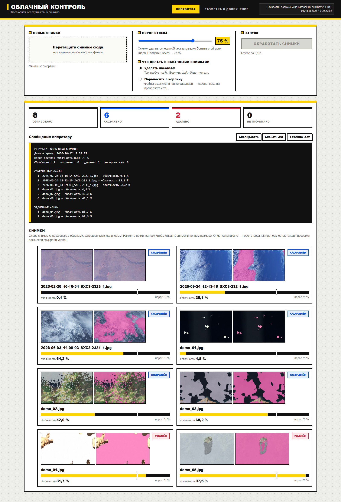

# Облачный контроль

**ИИ для распознавания облачности на спутниковых снимках.**  
Кейс компании «Спутникс», Sk Challenge 2026 Kids, возраст 14+.

Программа для каждого снимка считает процент облачности, удаляет кадры, где облаков больше 75 %, и выдаёт оператору сообщение: имя сохранённого файла, процент облачности и имя удалённого файла.



## Демо

- 🎬 **[Короткое видео, 40 секунд](video/demo.mp4)** — обработка 8 снимков, удаление двух облачных.
- 📊 **[Презентация, 16 слайдов](presentation.pptx)** — устройство алгоритма, метрики и демонстрация.
- 🎥 **[Полная запись, 2 минуты](video/full_demo.mp4)** — более подробный показ интерфейса.

## Быстрый старт

Нужен Python 3.10 или новее.

```bash
git clone https://github.com/renalmur/desktop-tutorial.git
cd cloud-control

python -m venv .venv
.venv\Scripts\activate          # Windows
# source .venv/bin/activate     # macOS / Linux

pip install -r requirements.txt

python tools/make_demo.py --prepare
python app.py
```

Откройте **http://127.0.0.1:8000** и нажмите **«Обработать папку»**.

На Windows можно проще:

- `run_windows.bat` — первый запуск и установка библиотек;
- `run_demo.bat` — вернуть демонстрационные снимки и сразу открыть интерфейс.

> **Осторожно:** в режиме «Удалять насовсем» облачные снимки стираются с диска. Для безопасной проверки выберите «Переносить в корзину» или запустите `python process.py --dry-run`.

## Что умеет

- Распознаёт облака по пикселям и считает процент облачности.
- Удаляет снимки с облачностью **выше 75 %**; ровно 75 % — сохраняет.
- Показывает сообщение оператору с тремя обязательными пунктами.
- Сохраняет отчёты в TXT, CSV и JSON.
- Умеет работать без браузера: `python process.py`.
- Даёт размечать свои снимки кистью и дообучать сеть.
- Не удаляет битые файлы: сначала проверяет, что снимок читается.

## Результаты

| Проверка | Результат |
|---|---|
| 300 новых учебных снимков | средняя ошибка **1,7 п.п.**, верных решений **99 %** |
| 39 реальных снимков Спутникса | средняя ошибка **9,2 п.п.**, смещение **−6 п.п.** |
| Ложных удалений на учебных | **1 из 225** |
| Снег и лёд | известное ограничение: **14,4 п.п.** |

Подробные отчёты с картинками:

- [quality_report.html](reports/quality_report.html) — учебные снимки;
- [real_quality_report.html](reports/real_quality_report.html) — настоящие снимки Спутникса.

**Честное ограничение:** в реальном наборе не оказалось снимков с облачностью выше 75 %, поэтому удаление на реальных данных проверено только косвенно — на учебных снимках и в демонстрации. Это ограничение данных, а не алгоритма.

## Как это работает

```
снимок → 14 признаков → нейросеть 14→32→16→1 → маска → процент → решение
```

1. Снимок уменьшается до длинной стороны 384 пикселя.
2. Для каждого пикселя считаются 14 признаков: цвет, яркость, насыщенность, яркость и пестрота вокруг.
3. Нейросеть на 1025 весах даёт вероятность облака.
4. Пиксели с вероятностью выше 0,5 считаются облачными; карта слегка сглаживается.
5. Процент считается только по пикселям, где есть данные; чёрные поля по краям не учитываются.
6. Если процент больше 75 — снимок удаляется, иначе переносится в `data/saved`.

Вся сеть — три строки формул:

```python
h1 = relu(x  @ W1 + b1)
h2 = relu(h1 @ W2 + b2)
p  = sigmoid(h2 @ W3 + b3)
```

## Данные

Для обучения использованы:

- **600 сцен генератора** с точными масками (`cloudai/synth.py`);
- **88 реальных снимков Спутникса**, из них **11 размечено вручную** — 61 004 пикселя.

В репозитории лежат только **3 настоящих снимка** для демонстрации и **3 размеченных снимка** для вкладки «Разметка». Полный набор занимает около 450 МБ и не хранится в Git. Его можно скачать:

```bash
python tools/fetch_sputnix.py --count 40
```

Снимки Спутникса — открытые данные, разрешены для некоммерческого, образовательного и научного использования со ссылкой на проект. Условия и список файлов: `data/real_extra/README_cloud.md`, `data/real_extra/manifest.json`.

## Структура

```
cloud-control/
├── app.py                 интерфейс оператора (FastAPI)
├── process.py             обработка папки из командной строки
├── train.py               обучение сети
├── evaluate.py            проверка качества, HTML-отчёт
├── cloudai/               чтение снимков, признаки, сеть, обучение, обработка
├── static/                страница интерфейса (HTML, CSS, JavaScript)
├── models/                веса сети
├── data/                  демо-снимки, разметка, маски, отчёты
├── tests/                 44 автотеста
├── tools/                 демо, презентация, видео, скачивание данных
├── video/                 короткое и полное видео
├── presentation.pptx      презентация кейса
├── reports/               отчёты и скриншоты
├── GUIDE_RU.md            объяснение для команды
└── run_windows.bat        запуск в один клик
```

## Презентация и материалы для защиты

- [presentation.pptx](presentation.pptx) — 16 слайдов с заметками.
- [ВЫСТУПЛЕНИЕ.md](ВЫСТУПЛЕНИЕ.md) — сценарий на 3 и 7 минут.
- [ВОПРОСЫ_ЖЮРИ.md](ВОПРОСЫ_ЖЮРИ.md) — 18 частых вопросов с ответами.
- [ДЕМОНСТРАЦИЯ.md](ДЕМОНСТРАЦИЯ.md) — пошаговый показ и страховка.
- [ПЛАН_ПОБЕДЫ.md](ПЛАН_ПОБЕДЫ.md) — критерии, риски и чек-лист.
- [GUIDE_RU.md](GUIDE_RU.md) — как всё устроено, простым языком.

## Тесты

```bash
pytest -q
```

Ожидается: **44 passed**.

## Ограничения

- **Снег и лёд** принимаются за облака: в цветном снимке нет инфракрасных каналов.
- **Тонкая дымка** почти не отличается от земли.
- **Тёмные и пересвеченные снимки** смещают процент.
- Модель **занижает** облачность на реальных снимках в среднем на 6 п.п. — это безопаснее ложного удаления, но облачный кадр может остаться на диске.

Мы измеряем эти ограничения и показываем их, а не прячем.

## Лицензия и данные

Код проекта — MIT (см. [LICENSE](LICENSE)).

Данные:

- снимки Спутникса — открытые данные, образовательное использование со ссылкой на проект;
- снимок Sentinel-2 в `data/real_check` — CC BY-SA 4.0, Copernicus Sentinel-2, проект s2cloudless;
- учебные снимки — генератор `cloudai/synth.py`.

## Команда

Команда: **впишите имена участников**  
Возраст: 14+  
Направление: космические технологии
